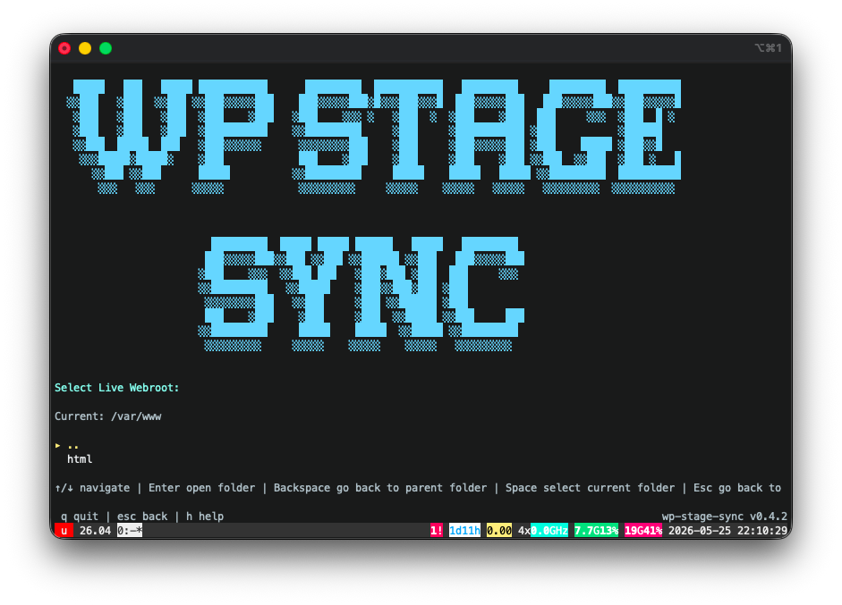
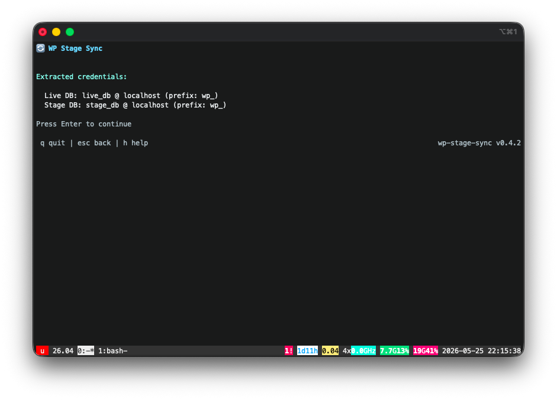
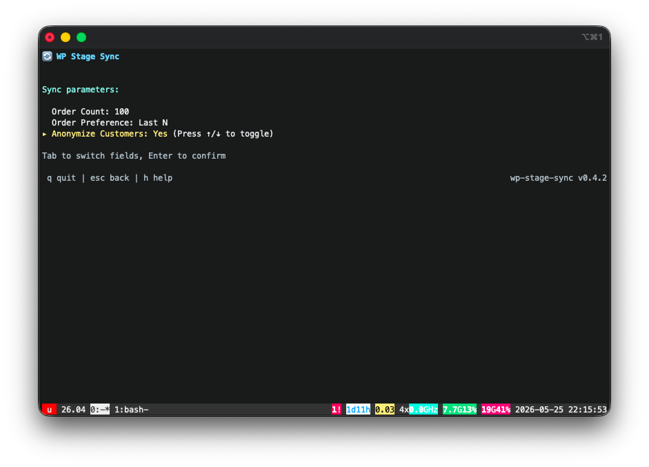
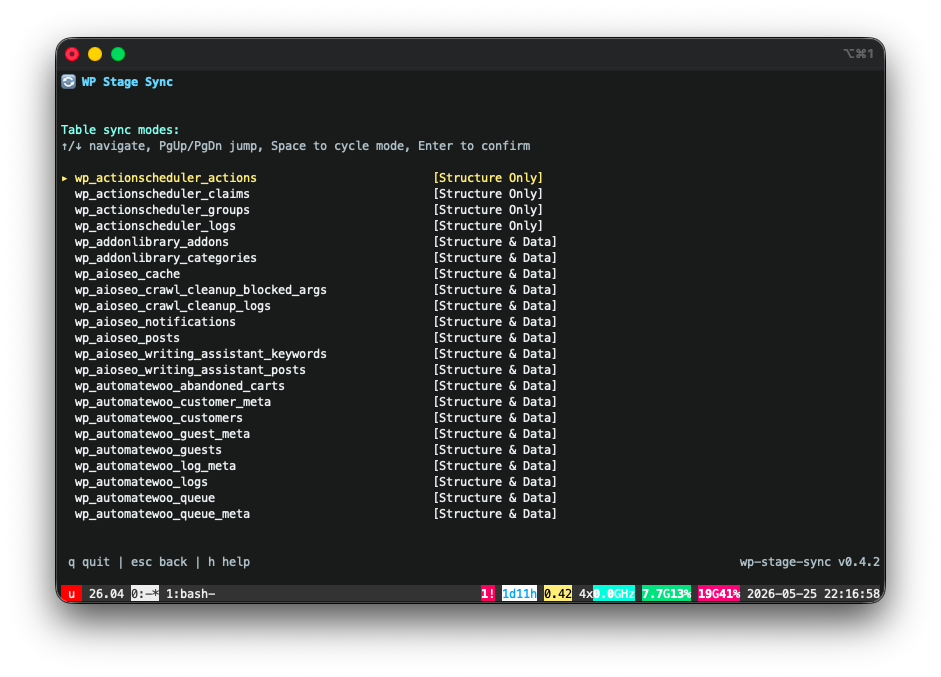
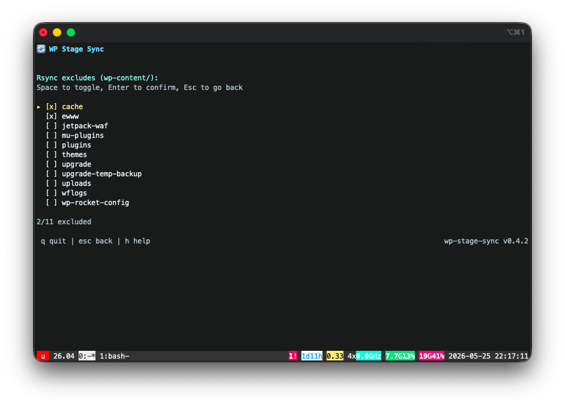
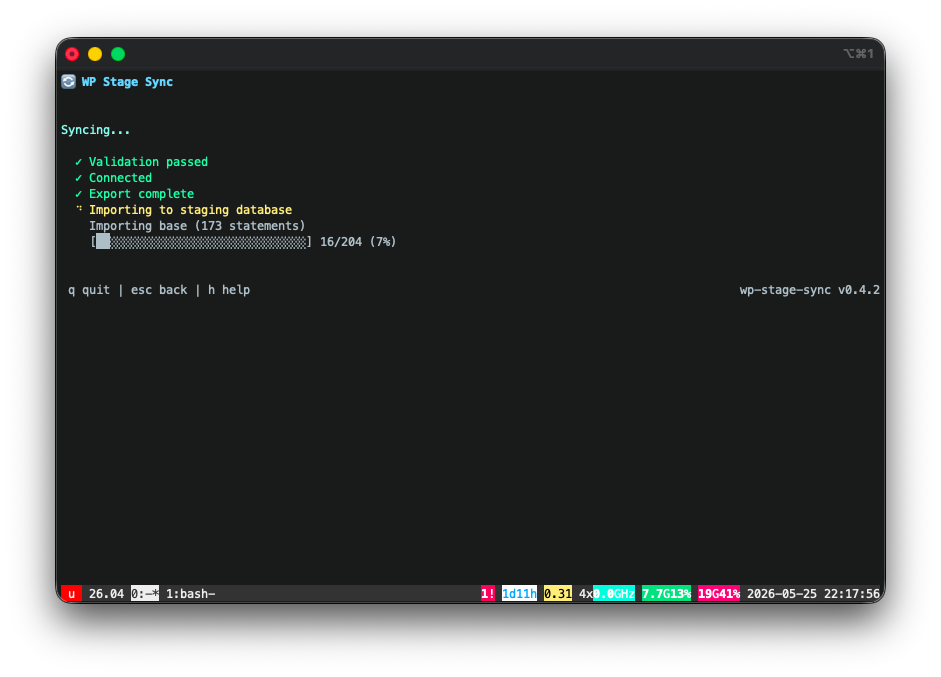
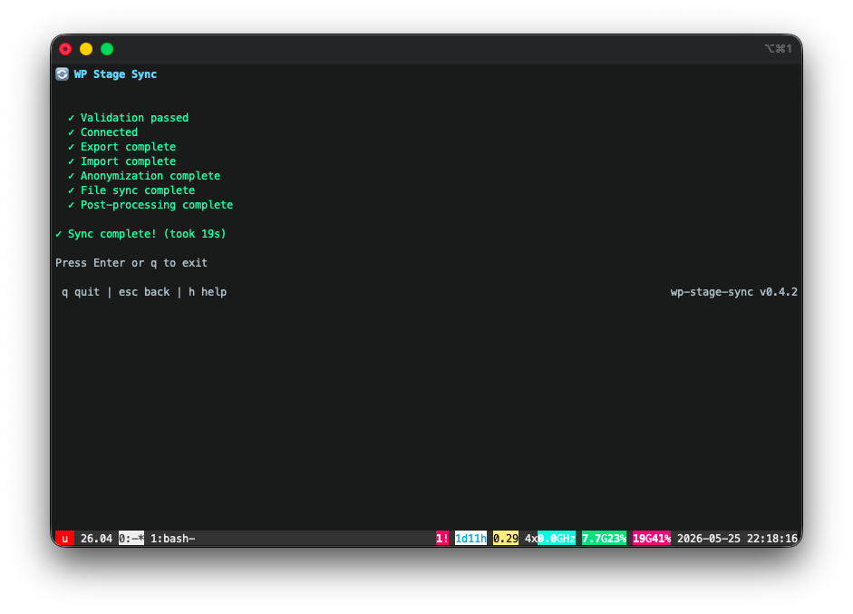

# WP Stage Sync

A TUI (Terminal User Interface) tool to synchronize WordPress sites between live and staging environments. Pull live to staging with smart WooCommerce order filtering and customer anonymization, or promote specific themes/plugins from staging to live with automated backup and automatic restore.



## What it does

### Live → Staging (default mode)

- **Smart Detection**: Automatically detects whether WooCommerce is installed.
- **WooCommerce Filtering (HPOS and legacy order store)**: Copies staging database with **filtered order data** — only the N orders you specify, not the entire order history.
- **Customer Anonymization**: Optionally masks billing/shipping addresses, customer names, emails, and phone numbers in the staging environment.
- **Non-customer preservation**: Keeps all admins, editors, and shop manager accounts fully intact.
- **Full WordPress Sync**: Works seamlessly with clean, non-WooCommerce WordPress instances as a fast, full sync tool.
- **File Sync**: Syncs `wp-content/` via rsync with customizable folder exclusion.
- **Domain Mapping**: Runs search-replace for domain URLs and handles Elementor / Jetpack URL settings automatically.
- **Production Guardrails**: In this mode the tool **never writes to production** — read-only access to the live database, all changes target staging only.

### Staging → Live (promote mode)

- **Surgical Promote**: Select specific themes, plugins, and mu-plugins to promote from staging to live.
- **Automated Backup**: Creates a tar.gz backup of live assets before any changes, with configurable retention.
- **Automatic Restore**: Automatically restores from backup if any rsync operation fails mid-promote.
- **Restore Mode**: Browse and restore any previous backup from the TUI.

## Requirements

- Go 1.21+ (build only)
- Linux server with:
  - MySQL/MariaDB
  - rsync
  - WP-CLI
  - Apache2, Nginx, LiteSpeed Enterprise or OpenLiteSpeed (optional, used for auto-discovery)

## Install

### Quick install (Linux)

```bash
curl -sL "https://github.com/AdaDigitalAgency/wp-stage-sync/releases/latest/download/wp-stage-sync_linux_$(uname -m | sed 's/x86_64/amd64/;s/aarch64/arm64/')" -o /tmp/wp-stage-sync && chmod +x /tmp/wp-stage-sync && sudo mv /tmp/wp-stage-sync /usr/local/bin/wp-stage-sync
```

### From source

```bash
go install github.com/AdaDigitalAgency/wp-stage-sync/cmd/wp-stage-sync@latest
```

## Usage

### Interactive mode (TUI)

```bash
wp-stage-sync
```

Walks you through:

1. **Path selection** — auto-discovers WordPress installs from web server vhosts (Apache, cPanel, Nginx, LiteSpeed Enterprise XML config, OpenLiteSpeed) and filesystem
2. **Credential extraction** — parses `wp-config.php` automatically
3. **WooCommerce Sync Options** — (If WooCommerce is present) select order count, preference, and choose whether to anonymize customer profiles
4. **Table selector** — choose sync mode per table (Structure & Data / Structure Only / Ignore / Custom Rule)
5. **Rsync Exclude selector** — interactively toggle which `wp-content/` folders to exclude from file sync
6. **Confirm & sync**

Settings are saved to `~/.config/wp-stage-sync/sites/` for reuse.

### Promote mode

```bash
wp-stage-sync --promote
```

Promotes selected themes, plugins, and mu-plugins from staging to production. Creates a backup before each operation. Press `p` on the startup screen for quick access.

### Restore mode

```bash
wp-stage-sync --restore
```

Browse previous backups and restore specific items to live. Press `r` on the startup screen when backups exist.

### Unattended mode

```bash
wp-stage-sync -u
```

Skips the TUI, reads saved config, and runs the sync immediately. Useful for cron jobs or scripts. If the site config has anonymization enabled, customer data is masked after import — same as the interactive flow.

### Dry-run mode

```bash
wp-stage-sync -n            # or --dry-run
wp-stage-sync -n -s example.com
```

Runs every discovery and planning step but **writes nothing** — no database mutations, no file changes, no WP-CLI commands. It prints a plan of what a real sync would do:

- **Database export** — target order count, safe-user count, and every table grouped into filtered (with the filter rule + row count), full-data, schema-only, and ignored, plus the total rows that would be exported.
- **Database import** — how many staging tables would be dropped and recreated.
- **Anonymization** — whether customer data would be masked (per the site setting).
- **File sync** — the rsync command plus a `rsync --dry-run --stats` transfer summary.
- **Post-processing** — each WP-CLI command marked `[run]` or `[skip]` with the reason.

Resolves config exactly like unattended mode, so `-s` / `--site` works the same way. Use it to preview a sync before running it for real.

### Multi-site targeting

```bash
wp-stage-sync -l            # or --list
```

Lists all configured sites. Use this to discover available site identifiers.

```bash
wp-stage-sync -u -s example.com
wp-stage-sync --promote --site example.com
```

When multiple sites are configured, use `-s` / `--site` to specify which one. The site identifier is the directory name under `~/.config/wp-stage-sync/sites/` — typically the domain or webroot basename. Supports servers with multiple WordPress installs on the same domain.

### Version & Help

```bash
wp-stage-sync --help
wp-stage-sync --version
```

### Self-update

```bash
wp-stage-sync --update
```

Downloads the latest release from GitHub and replaces the binary in-place.

### Config management

```bash
wp-stage-sync --delete --site example.com   # remove a single site's config and backups
wp-stage-sync --reset                       # wipe all saved configs
```

Both prompt for confirmation before deleting.

### Settings screen

Press `s` from the first screen of the TUI to access global settings:
- **Backup retention**: Maximum number of backups to keep per site (default: 5)
- **Auto cache flush**: Whether to automatically flush cache on the live site after promote and restore operations (default: ON)

Settings are persisted to `~/.config/wp-stage-sync/settings.json`.

## Documentation

The full documentation is on the [website](https://ada.tools/wp-stage-sync/docs/) and in [`docs/`](docs/):

- [Getting started](docs/getting-started.md): install and first sync
- [Interactive mode](docs/interactive.md): every TUI screen and key
- [Unattended mode and dry run](docs/unattended.md): flags, cron, the plan output
- [Configuration](docs/configuration.md): `config.json`, `settings.json`, excludes
- [How a sync works](docs/how-it-works.md): every step, in order
- [Cache plugins](docs/cache-plugins.md): what the sync does for each cache and CDN plugin
- [Object cache](docs/object-cache.md): flush rules, shared Redis databases, the stage object cache Off option
- [Servers](docs/servers.md): Apache, cPanel, Nginx and LiteSpeed discovery, site pairing
- [Promote and restore](docs/promote-and-restore.md)
- [Safety](docs/safety.md): guardrails and what each one refuses
- [Troubleshooting](docs/troubleshooting.md): every refusal and warning, and the fix

## How it works

1. **Checks.** Paths, databases and hosts are validated. Live settings that the staging cleanup must change are read and test-changed. The object cache isolation probe runs.
2. **Database.** Tables are exported from live with read-only queries (WooCommerce orders filtered) and imported into staging. Live CDN, Cloudflare and firewall credentials are cleared on staging right after the import.
3. **Files.** `wp-content/` is copied with rsync (`--delete`, anchored excludes). Live paths in copied cache configs are replaced with staging paths.
4. **Post-processing.** WP-CLI search-replace of URLs and paths, Elementor URL replace and CSS regenerate, a staging-only object cache flush, and staging page caches emptied. Cache and CDN plugins are skipped in these commands.

Details: [How a sync works](docs/how-it-works.md), [Cache plugins](docs/cache-plugins.md), [Object cache](docs/object-cache.md).

## Safety

The tool has built-in production guardrails:

- **Production database is never modified** — in both modes the live database connection only runs `SELECT` and `SHOW` queries. Zero `INSERT`, `UPDATE`, `DELETE`, or `DROP` statements touch the production database.
- **Live → Staging writes only to staging** — in the default sync, all `DROP TABLE`, `INSERT INTO`, rsync `--delete`, `chown`, and WP-CLI commands target the staging environment exclusively. Production is never written.
- **Promote writes production files, by design** — promote mode rsyncs the specific themes, plugins, and mu-plugins you select onto the live filesystem. It always takes a full backup first and automatically restores on failure — and it still never changes the production database.
- **Live integrations switched off on staging** — CDN, Cloudflare, Sucuri and Varnish credentials copied from live are cleared on staging, so neither the sync nor the staging admin can purge live's CDN.
- **No live paths on staging** — copied config files and stored paths are rewritten, so staging never loads live's plugin code or deletes live's cache and minified files.
- **Object cache isolation** — the only WP-CLI commands on live are reads of one probe key, with plugins and themes skipped and WP-Cron off. The sync stops before any change if staging would share live's cache keys, and the staging flush never clears live's cache.
- **Path validation** — aborts if live and stage paths resolve to the same directory (symlinks resolved).
- **Database validation** — aborts if live and stage resolve to the same database, compared by the connected server's identity rather than just the configured host string.

> **Anonymization scope:** masking covers standard WooCommerce/WordPress customer fields (users, usermeta, order records and addresses in both order stores, analytics customers, order notes). It does **not** guarantee that every plugin's stored PII or secret (API keys, payment/SMTP credentials, custom tables) is scrubbed. Treat staging as sensitive and secure it accordingly.

## Screenshots

| Credential extraction | Sync parameters | Table sync modes |
|:---:|:---:|:---:|
|  |  |  |
| **Rsync excludes** | **Sync in progress** | **Results** |
| [](website/public/images/screenshot-05.png) | [](website/public/images/screenshot-06.png) | [](website/public/images/screenshot-07.png) |

## Project structure

```
cmd/wp-stage-sync/main.go     Entry point, CLI flags, unattended orchestration
internal/
├── config/config.go          JSON config persistence (~/.config/wp-stage-sync/sites/)
├── db/db.go                  DB connection (root socket → wp-config fallback)
├── discovery/                Apache2, Nginx, LiteSpeed vhost + filesystem auto-discovery
├── export/export.go          Core export engine (orders in both stores, users, base)
├── guardrail/guardrail.go    Production safety checks (path, DB, wp-content)
├── promote/promote.go        Stage → live promote engine (backup, rsync, restore)
├── sync/                     Import, rsync, WP-CLI post-processing, cache and CDN cleanup
├── tui/tui.go                Bubbletea interactive wizard
└── wpconfig/wpconfig.go      wp-config.php parser
docs/                         User documentation (also the website's docs pages)
website/                      Astro site for ada.tools/wp-stage-sync
```

## WooCommerce compatibility

- **HPOS and the legacy order store**: both are filtered. With HPOS the target orders come from `wc_orders`, otherwise from `wp_posts`. Order copies that HPOS compatibility sync keeps in `wp_posts` are filtered too.

## License

[MIT](LICENSE)
